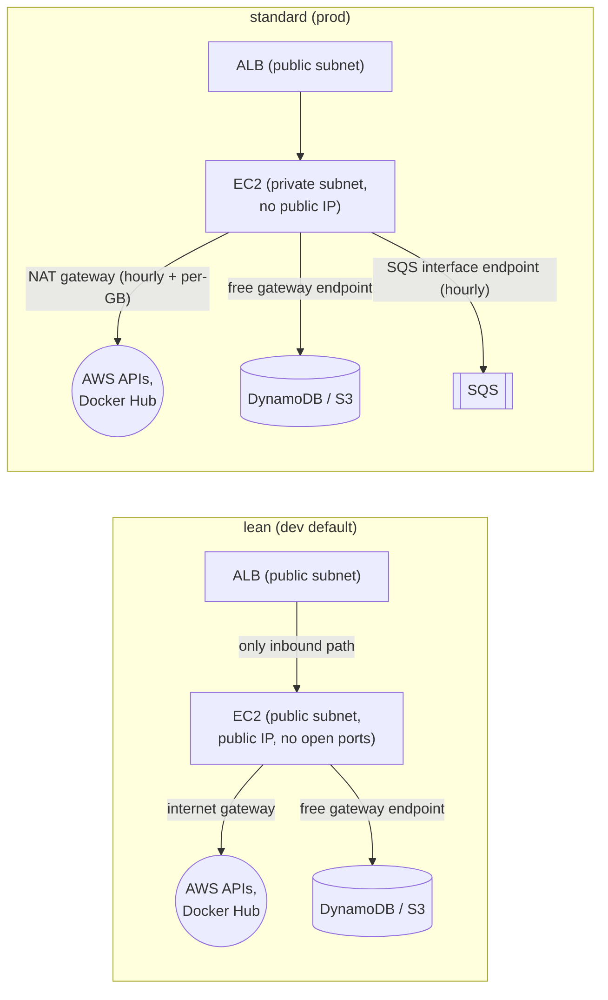

# RailPulse Ops — Architecture

One trackside reading's path, from rail to gangman's phone. Every arrow is labelled with what
it does; the dashed edges are the asynchronous hand-offs that let each stage fail and retry
on its own.

```mermaid
flowchart LR
    subgraph Track["Trackside"]
        S["Sensors<br/>VIB · TMP · UTS · SWT"]
    end

    subgraph Ingest["Ingest (Core stack)"]
        IOT["IoT Core<br/>X.509 per sensor"]
        Q[["SQS telemetry-q<br/>+ DLQ after 5 tries"]]
        FH["Data Firehose"]
        S3[("S3 data lake<br/>KMS")]
    end

    subgraph Detect["Detect (Worker env, EB)"]
        W["FastAPI /process<br/>rules + z-scores"]
        DDB[("DynamoDB<br/>Telemetry · Incidents<br/>Assets · Baselines")]
    end

    subgraph Alert["Alert (Alerting stack)"]
        EB{{"EventBridge bus"}}
        SF["Step Functions<br/>escalation ladder"]
        N["notify Lambda<br/>Translate · Polly"]
        SMS["SMS / SNS email"]
        HB["heartbeat Lambda<br/>every 5 min"]
    end

    subgraph Web["Dashboard (Web env, EB)"]
        CF["CloudFront + WAF"]
        API["nginx + FastAPI<br/>Cognito JWT"]
    end

    S -- "MQTT/TLS publish" --> IOT
    IOT -- "rule: fan-out" --> Q
    IOT -- "rule: fan-out" --> FH
    FH -- "gzip JSON, by division/day" --> S3
    Q -. "sqsd POSTs each message" .-> W
    W -- "telemetry, baselines,<br/>one incident per segment+type" --> DDB
    W -. "AnomalyDetected /<br/>IncidentEscalated" .-> EB
    EB -. "P1–P3" .-> SF
    EB -. "archive all" .-> FH
    SF -- "page rung, wait for ack token" --> N
    N --> SMS
    SMS -- "ack link /ack/?c=…" --> CF
    CF -- "X-Origin-Verify" --> API
    API -- "read, ack, resolve" --> DDB
    HB -- "silent sensors → HB messages" --> Q
```

**Why the queue and the bus matter:** the worker never waits on alerting, and IoT never waits
on the worker. A burst of trains only grows the SQS backlog, and the worker environment
scales out on that backlog. A slow SMS provider only delays one Step Functions execution.

## Lean (dev) vs standard (prod) network

The one difference that decides the monthly bill:

Lean drops the NAT gateway and the SQS interface endpoint, which together are the largest
always-on network charges, while keeping instances unreachable except through the ALB.
`-c lean=false` (or `-c stage=prod`) restores the private layout.

## Services (30)

| Layer | Services |
|---|---|
| Compute & deploy | Elastic Beanstalk (web + worker), EC2 + Auto Scaling, Application Load Balancer, Lambda, CodePipeline, CodeBuild |
| Ingest & messaging | IoT Core, SQS, Data Firehose, EventBridge (bus, Scheduler, archive), SNS |
| Data | DynamoDB, S3, Glue Data Catalog, Athena |
| Workflow & AI | Step Functions, Translate, Polly, End User Messaging SMS |
| Edge & identity | CloudFront, WAF, Cognito, Location Service |
| Security & ops | KMS, Secrets Manager, Systems Manager Parameter Store, IAM, CloudWatch (alarms, dashboard, logs), X-Ray, AWS Budgets |

## Guarantees and where they live

| Property | Mechanism | Code |
|---|---|---|
| One incident per crack, despite SQS redelivery | Conditional transaction on an `ACTIVE#<type>` pointer | `worker/app/store.py` |
| No lost alerts | `pending_event` flag on the incident, resent until EventBridge accepts it | `worker/app/processor.py` |
| No duplicate escalations | Step Functions execution name = incident + severity | `alerting/.../handlers/start.py` |
| SMS link previews can't acknowledge | GET shows the alert, only POST confirms | `alerting/.../handlers/ack.py` |
| WAF can't be bypassed | ALB admits CloudFront ranges only, plus a secret origin header checked by nginx and the ack Lambda | `infra/.../web_stack.py`, `webproxy/` |
| Silence is noticed | Heartbeat turns missing readings into queue messages | `alerting/.../handlers/heartbeat.py` |
| A runaway query can't run up the bill | Athena workgroup scan cap of 1 GB | `infra/.../analytics_stack.py` |
